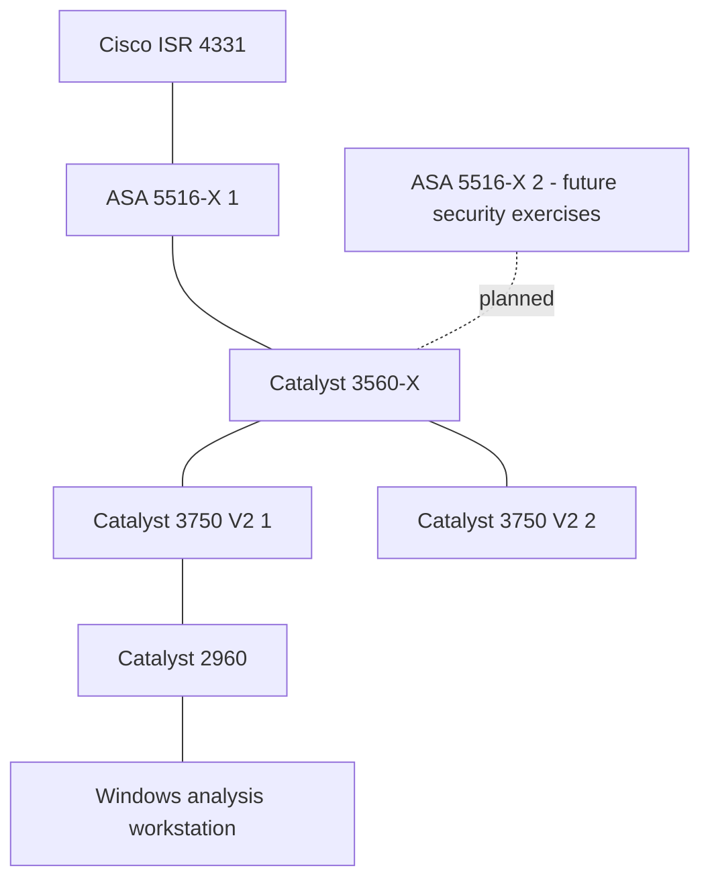

# DavidG Home Lab | Proposed Physical Topology

**Status:** Design proposal, not a verified deployment. Interface assignments, addressing, firewall roles and redundancy will be confirmed during configuration.

This is a proposed logical arrangement of the seven existing Cisco devices. No failover or redundancy is claimed. Validate cabling and platform capabilities before implementation.
