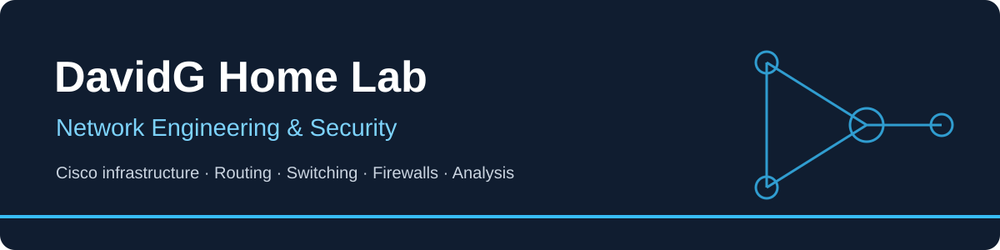
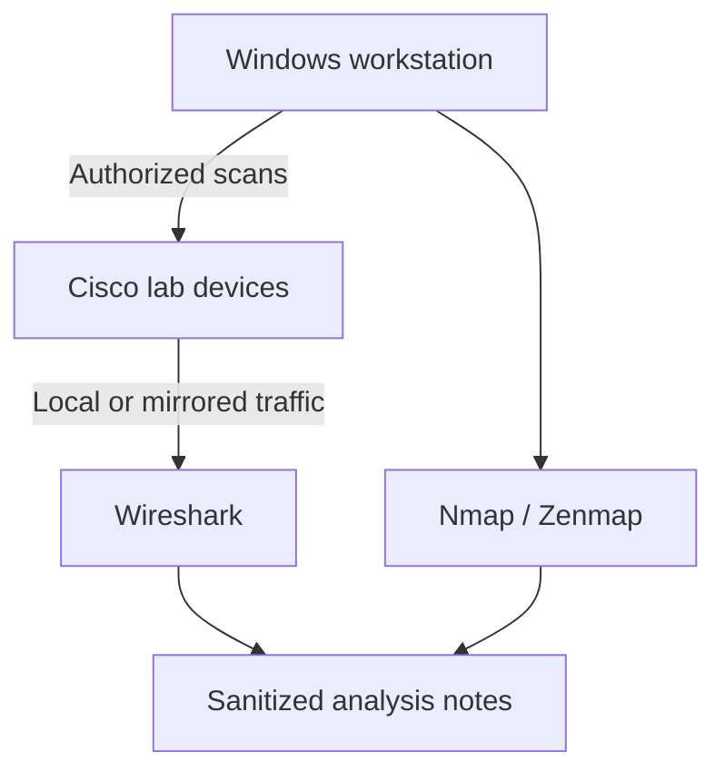

# DavidG Home Lab | Network Engineering & Security

**Professional focus:** Network engineering, network administration and infrastructure security. **Certification:** Cisco CCNA.

[Proposed network topology](./01-network-architecture/planned-topology.md) · [Project progress tracker](./09-project-documentation/progress.md)

A hands-on enterprise IT environment for designing, deploying, securing, monitoring, and troubleshooting network and system infrastructures.

## 1. Lab Equipment

- Cisco ISR 4331 Router
- 2 × Cisco ASA 5516-X Firewalls
- Cisco Catalyst 3560-X Core Switch
- 2 × Cisco Catalyst 3750 V2 Distribution Switches
- Cisco Catalyst 2960 Access Switch

## 2. Enterprise Networking

**Routing and Layer 3**
- Static Routing, OSPF, EIGRP, BGP and RIP
- IPv4 and IPv6
- Route Redistribution and Summarization
- Policy-Based Routing

**Switching and Layer 2**
- VLANs and 802.1Q Trunking
- STP, RSTP and MSTP
- EtherChannel, LACP and PAgP
- Inter-VLAN Routing
- HSRP, VRRP and GLBP

**WAN and VPN Technologies**
- GRE Tunneling
- IPsec Site-to-Site VPN
- Remote Access VPN
- DMVPN
- WAN Connectivity

## 3. Network and Infrastructure Security

- Cisco ASA Firewall Configuration
- Access Control Lists (ACLs)
- NAT and PAT
- Network Segmentation
- Port Security
- DHCP Snooping and Dynamic ARP Inspection
- AAA, RADIUS and TACACS+
- Secure Network Access

## 4. Enterprise Infrastructure Services

- DHCP and DNS
- NTP and SSH
- SNMP and Syslog
- Quality of Service (QoS)
- Network Addressing and Subnetting
- Network Discovery and Management

## 5. Monitoring and Security Architecture

- Wireshark — packet capture and protocol analysis.
- Nmap / Zenmap — authorized network discovery and port scanning.

### Planned Monitoring Architecture

The Windows workstation will use Wireshark for on-demand packet analysis and Nmap / Zenmap for authorized discovery and service assessment. These are not continuous monitoring or alerting platforms. Capture locally or through a configured switch SPAN port when supported. No additional monitoring software or Linux monitoring servers are in scope.

## 6. Engineering Objectives

- Design and deploy enterprise network architectures.
- Implement routing, switching and WAN technologies.
- Configure firewalls and secure network infrastructure.
- Develop VPN connectivity and network redundancy.
- Deploy monitoring and security solutions.
- Document configurations, diagrams and technical procedures.
- Perform troubleshooting and authorized security testing.

## 7. Project Status

**Status: In Progress**

All technologies are planned learning and implementation areas. Hardware, software, licensing and feature compatibility will be verified before deployment.

## 8. Security

All configurations and testing will be performed in an authorized lab environment. Passwords, credentials, private keys, tokens and sensitive network information will never be published.

## 9. Project sections

- [network architecture](./01-network-architecture/README.md)
- [device inventory](./02-device-inventory/README.md)
- [network configuration](./03-network-configuration/README.md)
- [network security](./04-network-security/README.md)
- [network monitoring](./05-network-monitoring/README.md)
- [network administration](./06-network-administration/README.md)
- [security and auditing](./07-security-and-auditing/README.md)
- [troubleshooting and testing](./08-troubleshooting-and-testing/README.md)
- [project documentation](./09-project-documentation/README.md)
